# 실습1) CRUD 백엔드 만들기

실행: `./gradlew bootRun` → `http://localhost:8080`

## 1. HTTP 메서드별 API (총 8개)

| 메서드 | 경로 | 설명 |
|---|---|---|
| POST | `/api/v1/items` | 아이템 생성 |
| POST | `/api/v1/items/bulk` | 아이템 여러 개 생성 |
| GET | `/api/v1/items?keyword=&page=&size=` | 목록 조회 |
| GET | `/api/v1/items/{id}` | 단건 조회 |
| PUT | `/api/v1/items/{id}` | 아이템 전체 수정 |
| PUT | `/api/v1/items/{id}/price` | 가격만 수정 |
| DELETE | `/api/v1/items/{id}` | 단건 삭제 |
| DELETE | `/api/v1/items` | 전체 삭제 |

## 2. 미들웨어

- `LoggingInterceptor`: 모든 요청의 메서드, URI, 응답 상태코드, 처리 시간 로그 출력
- `ServiceStatusInterceptor`: 점검 모드(`app.maintenance-mode=true`)일 때 요청을 차단하고 503 응답

## 3. HTTP 응답 코드

| 분류 | 코드 | 발생 상황 |
|---|---|---|
| 2xx | 200 OK | 조회, 수정, 삭제 성공 |
| 2xx | 201 Created | 생성 성공 |
| 4xx | 400 Bad Request | 입력값 검증 실패, 잘못된 JSON |
| 4xx | 404 Not Found | 존재하지 않는 아이템 |
| 4xx | 409 Conflict | 이름 중복 |
| 5xx | 500 Internal Server Error | 서버 내부 오류 |
| 5xx | 503 Service Unavailable | 점검 모드 |

※ 5xx 테스트: 요청 헤더에 `X-Simulate-Error: 500` 또는 `X-Simulate-Error: 503` 추가하여 임의로 확인 가능하도록 구성.

## 4. 표준 응답 형식

```json
{ "status": "success", "code": 201, "message": "Item created", "data": { "id": 1, "name": "apple", "price": 1000 } }
```
```json
{ "status": "error", "code": 404, "message": "Item not found: id=99" }
```

모든 응답은 `ApiResponse` 형식으로 반환하고, 에러는 `GlobalExceptionHandler`에서 같은 형식으로 변환.
(503은 ServiceStatusInterceptor에서 직접 응답)

## 5. 실행 및 테스트 화면

스크린샷은 `docs/screenshots/` 폴더에 정리하고 README에서 바로 확인할 수 있도록 링크함.(LMS 과제제출란에도 첨부파일로 첨부)

### 서버 실행
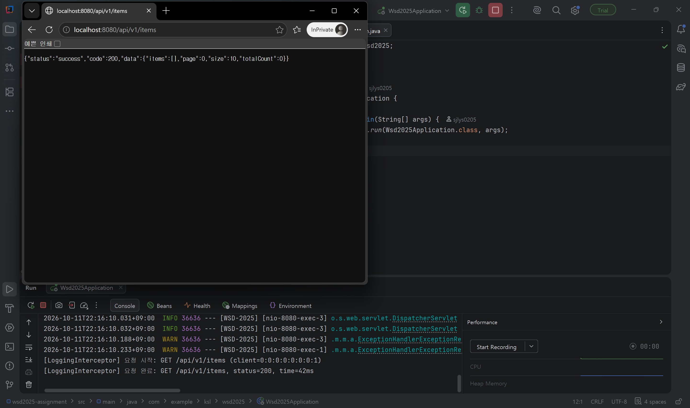

### POST
| 아이템 생성 → 201 | 입력값 검증 실패 → 400 |
|---|---|
| 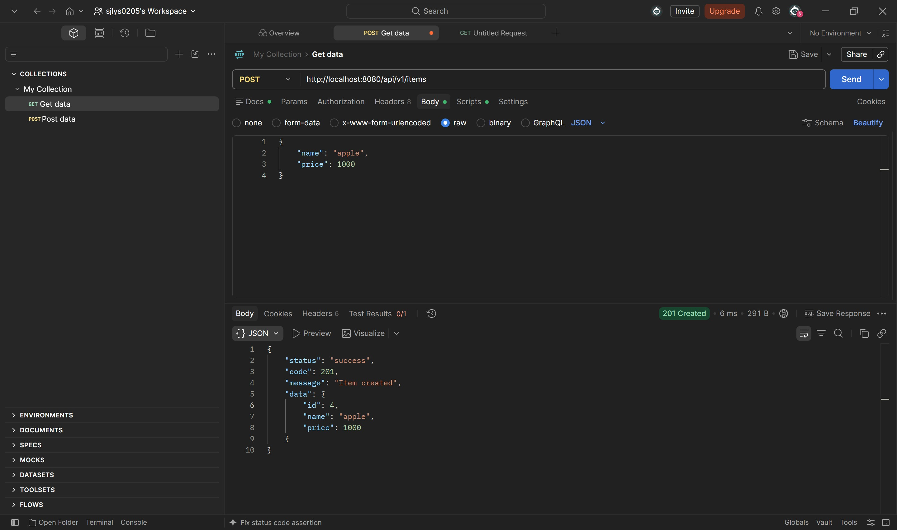 | 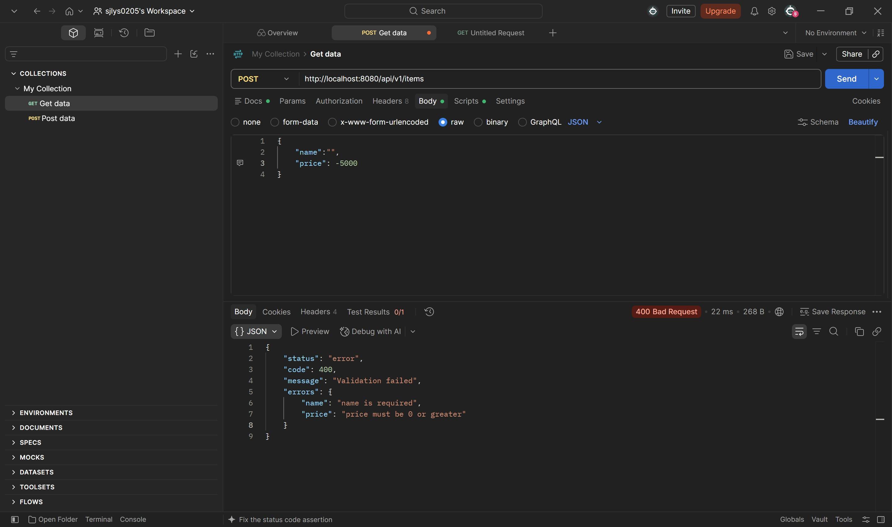 |

| 아이템 여러 개 생성 → 201 |
|---|
| 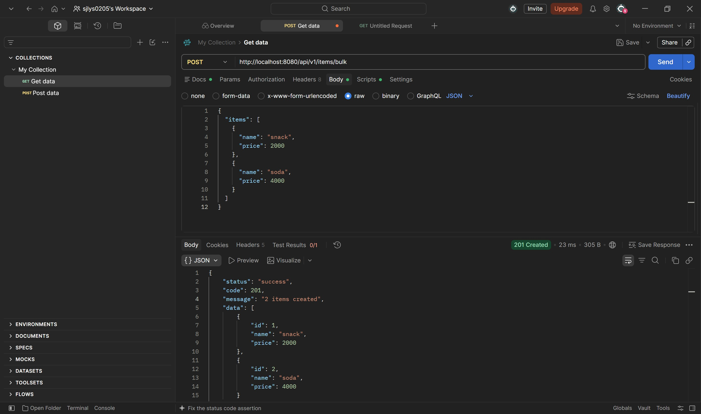 |

### GET
| 목록 조회 → 200 | 단건 조회 → 200 |
|---|---|
| 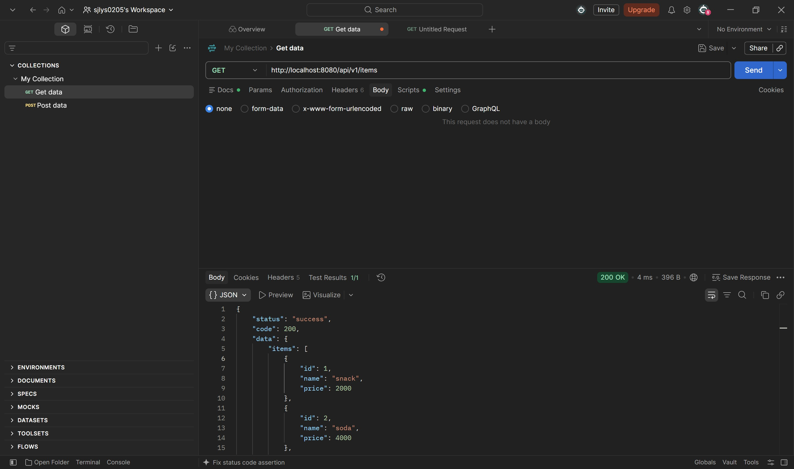 | 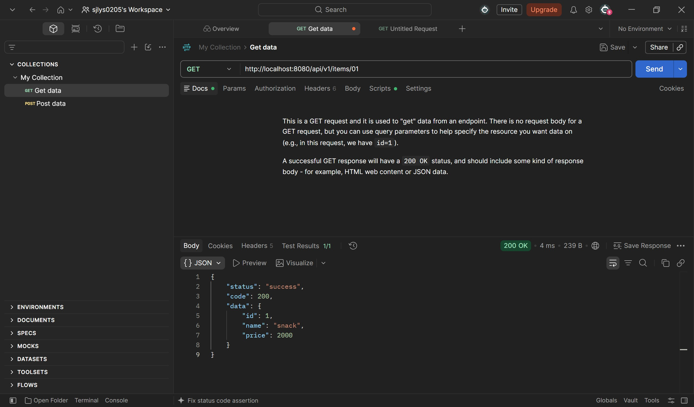 |

| 존재하지 않는 아이템 조회 → 404 |
|---|
| 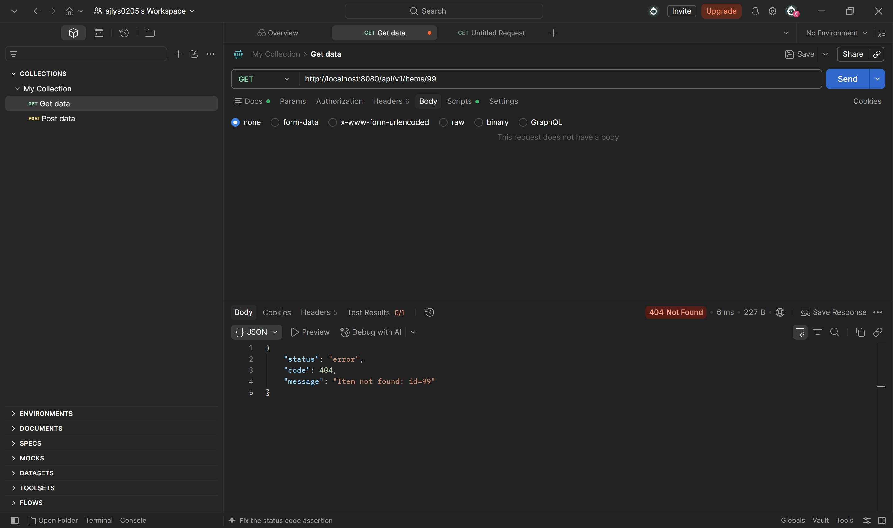 |

### PUT
| 가격만 수정 → 200 | 전체 수정 → 200 |
|---|---|
| 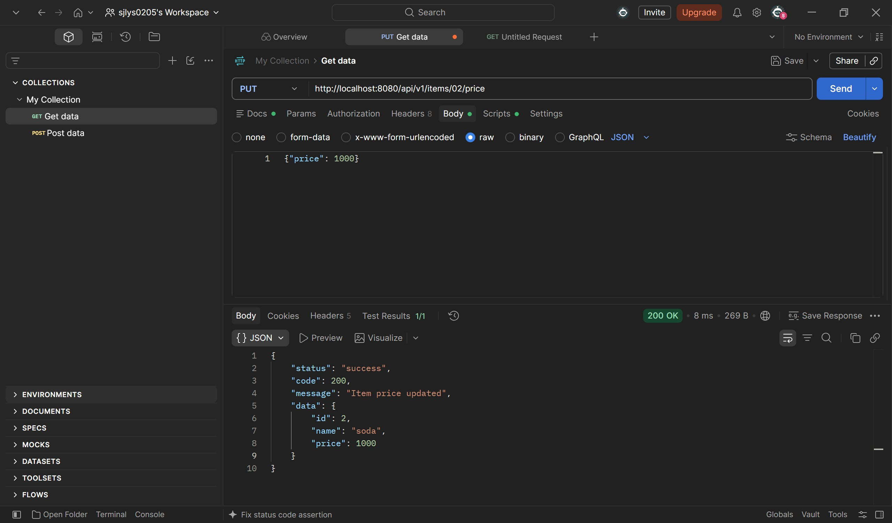 | 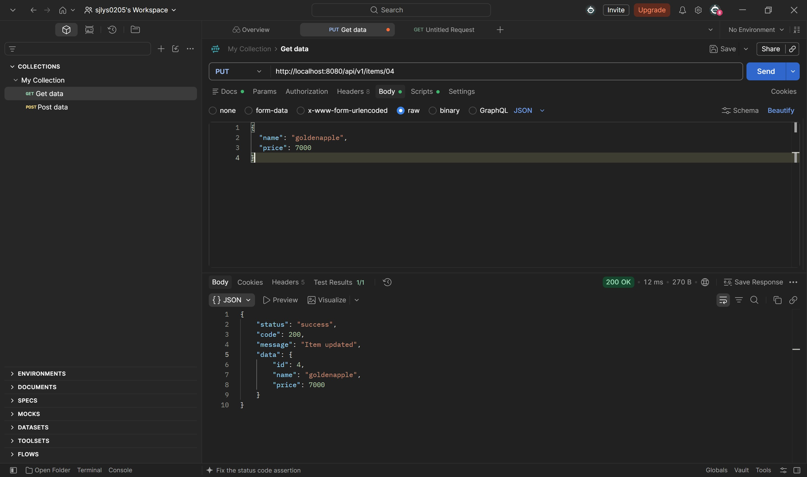 |

| 존재하지 않는 아이템 수정 → 404 |
|---|
|  |

### DELETE
| 단건 삭제 → 200 | 존재하지 않는 아이템 삭제 → 404 |
|---|---|
| 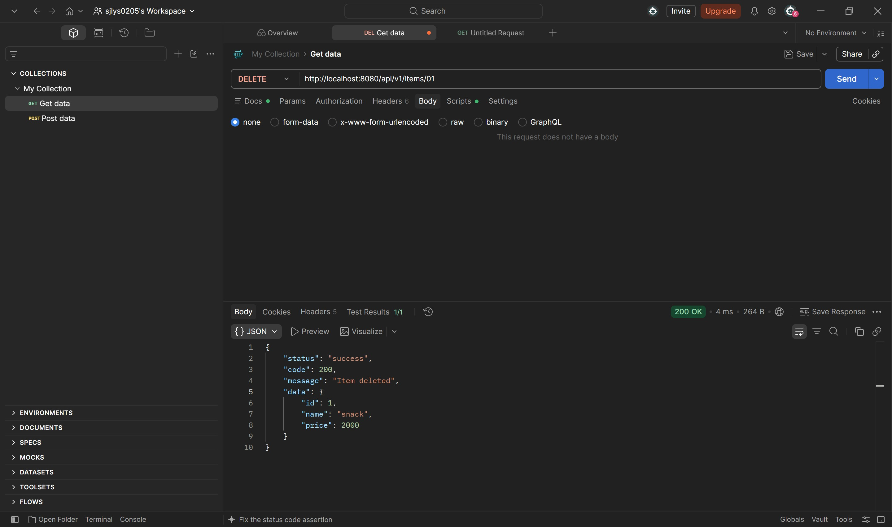 | 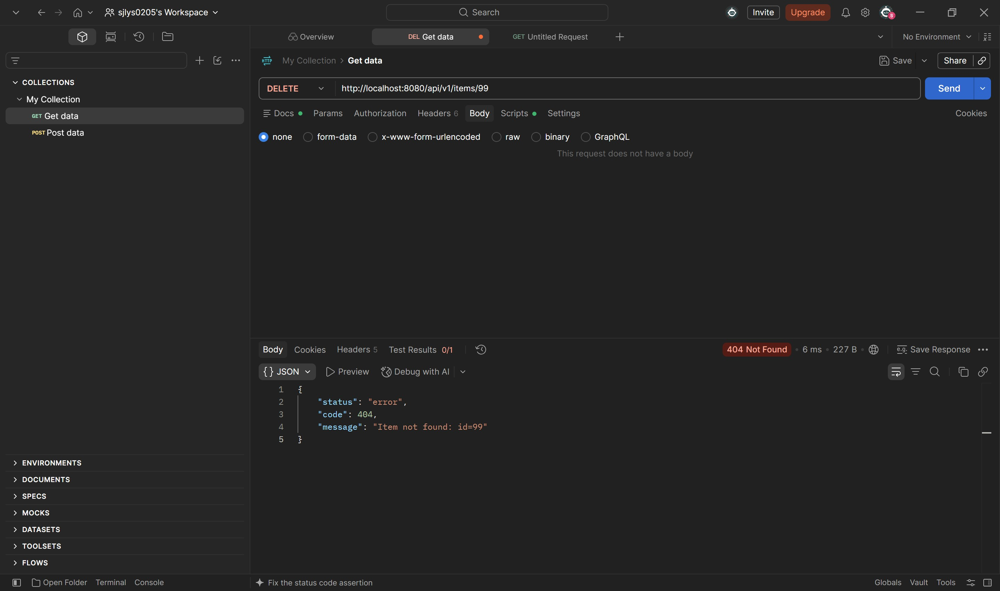 |

| 전체 삭제 → 200 |
|---|
| 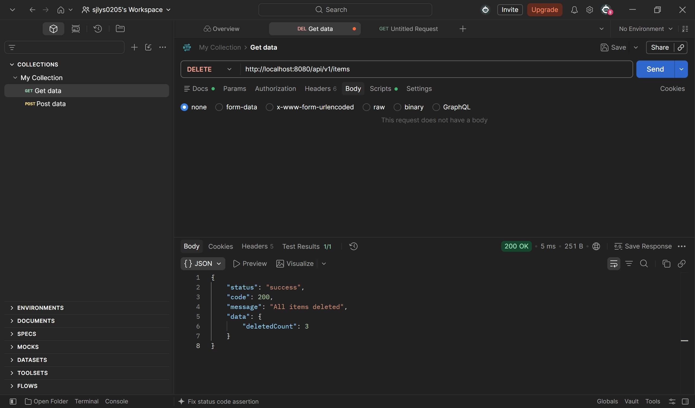 |

### 5xx 응답
| 점검 모드 → 503 | 서버 내부 오류 → 500 |
|---|---|
| 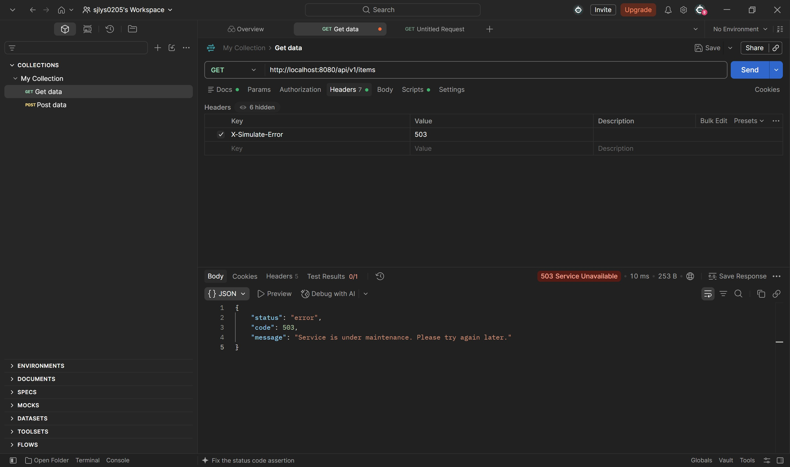 | 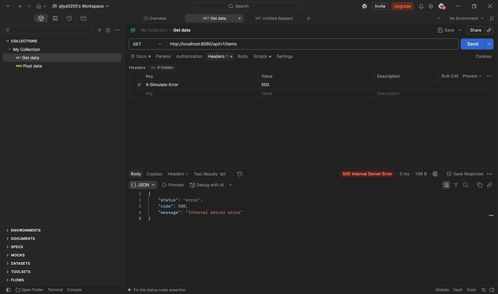 |

### 미들웨어 로그 (LoggingInterceptor)
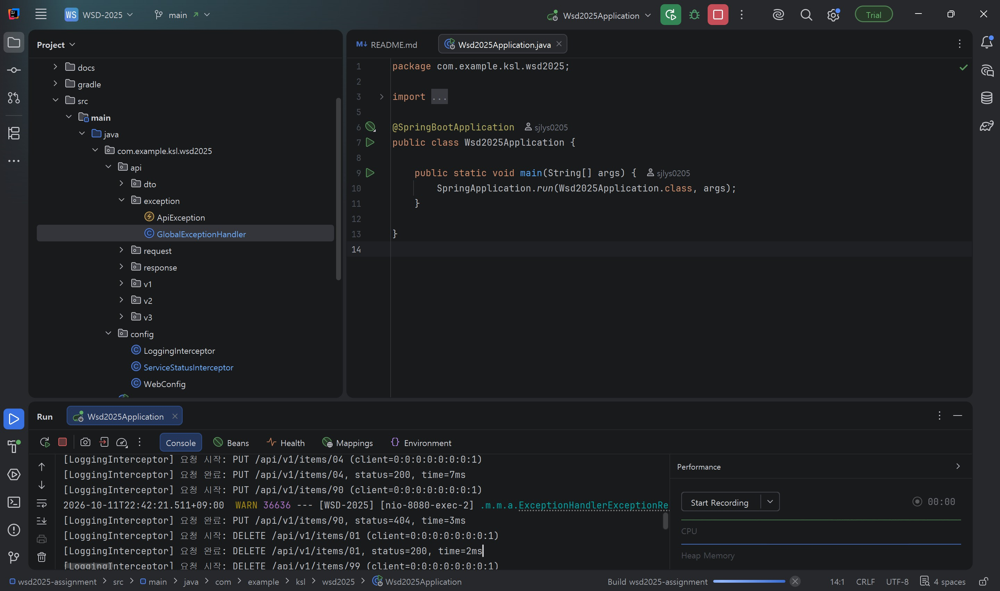
